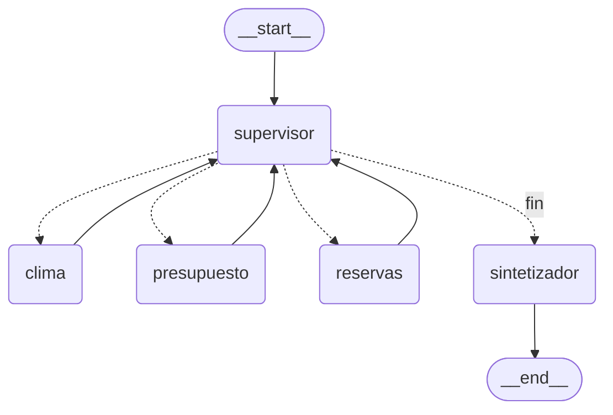

# Planeador de fin de semana multiagente

Sistema multiagente para la planeación de salidas de fin de semana cerca de Bogotá, desarrollado con **LangGraph, LangChain y Ollama**. Un supervisor coordina tres agentes especialistas (clima, presupuesto y reservas), que consultan herramientas con datos simulados, y un sintetizador redacta la respuesta final.

Proyecto del taller *Planeador de fin de semana multiagente con LangGraph y Ollama*, de la asignatura Aplicaciones basadas en grandes modelos de lenguaje (Universidad El Bosque).

## 1. Objetivo

Construir un asistente que ayude a planear salidas de fin de semana teniendo en cuenta el clima, el presupuesto disponible y la posibilidad de reservar cupos.

## 2. Tecnologías utilizadas

- Python 3.11 o superior (probado con 3.12 y 3.14)
- LangGraph, LangChain y LangChain Ollama
- Ollama con el modelo local `qwen2.5:3b` (soporta *tool calling*)
- FastAPI y Uvicorn
- HTML, CSS y JavaScript (frontend)
- Docker (opcional)

## 3. Arquitectura



| Pieza | Archivo | Qué hace |
|---|---|---|
| Datos simulados | `backend/src/datos.py` | Destinos, costos, pronósticos y cupos. |
| Herramientas | `backend/src/herramientas.py` | `listar_destinos`, `consultar_pronostico`, `estimar_costo`, `calcular_saldo`, `consultar_disponibilidad`, `crear_reserva`. |
| Agentes | `backend/src/agentes.py` | Clima, presupuesto y reservas, creados con `create_agent`. |
| Grafo | `backend/src/grafo.py` | Estado compartido, supervisor con salida estructurada (`Decision`), sintetizador, aristas condicionales, límite de 3 especialistas sin repetir y memoria conversacional. |
| API | `backend/src/api.py` | `POST /api/v1/chat` y `GET /health/llm`. |
| Configuración | `backend/src/config.py` | Modelo, URL de Ollama y `MAX_PASOS`. |

**Reto implementado:** memoria conversacional. El grafo se compila con `InMemorySaver` y cada conversación usa un `thread_id` (el `sessionId` del frontend), así que el usuario puede preguntar "¿Y el domingo?" sin repetir el destino.

## 4. Estructura del proyecto

```text
planeador-langgraph/
├── backend/
│   ├── Dockerfile
│   ├── requirements.txt
│   └── src/
│       ├── config.py
│       ├── datos.py
│       ├── herramientas.py
│       ├── agentes.py
│       ├── grafo.py
│       ├── main.py
│       ├── api.py
│       ├── prueba_ollama.py
│       └── prueba_agente.py
├── frontend/
│   ├── Dockerfile
│   └── src/index.html
├── tests/
│   ├── test_herramientas.py      ← pruebas de las herramientas sin modelo
│   ├── ejecutar_pruebas.py       ← seis preguntas de prueba + reto
│   └── ejecutar_pruebas.ps1      ← las mismas preguntas por la API
├── docs/
│   ├── bitacora.pdf              ← bitácora del taller
│   ├── grafo_langgraph.mmd / .png
│   └── evidencias/               ← resultados, trazas y pantallazos
├── docker-compose.yml
├── correr_pruebas.bat
├── requirements.txt
└── README.md
```

Todos los comandos se ejecutan **desde la raíz del repositorio**, porque el código se importa como `backend.src...`.

## 5. Instalación

```powershell
git clone https://github.com/alerojas-2005/planeador-langgraph.git
cd planeador-langgraph

python -m venv .venv
.\.venv\Scripts\Activate.ps1          # si PowerShell lo bloquea: Set-ExecutionPolicy -Scope Process -ExecutionPolicy Bypass
pip install -r requirements.txt

ollama pull qwen2.5:3b
ollama show qwen2.5:3b                 # en "Capabilities" debe aparecer: tools
```

## 6. Ejecución

### 6.1 Verificar la conexión con Ollama
```powershell
python -m backend.src.prueba_ollama
```

### 6.2 Chat por consola y diagrama del grafo
```powershell
python -m backend.src.main            # conversar con el planeador (la traza aparece en consola)
python -m backend.src.main --grafo    # imprime el grafo en Mermaid (pegarlo en https://mermaid.live)
```

### 6.3 API y frontend
Terminal 1, el backend:
```powershell
uvicorn backend.src.api:app --port 8080
```
Terminal 2, el frontend:
```powershell
python -m http.server 4200 --directory frontend/src
```
Abrir **http://localhost:4200**. La documentación de la API queda en http://localhost:8080/docs. La traza de los agentes aparece en la terminal de uvicorn. El frontend conserva la memoria en la misma pestaña: para empezar una conversación nueva, recargar la página.

### 6.4 Con Docker (alternativa)
```powershell
docker compose up -d --build
```
Levanta Ollama (descarga `qwen2.5:3b` la primera vez), el backend en el puerto 8080 y el frontend en el 4200.

## 7. Pruebas

```powershell
python -m pytest tests/test_herramientas.py -v              # herramientas sin modelo (23 pruebas)
python -m tests.ejecutar_pruebas --reto --salida docs/evidencias   # seis preguntas + reto, con traza y tiempos
```
También se puede dar doble clic en `correr_pruebas.bat`, que hace todo lo anterior. Los resultados, las trazas, los pantallazos y la revisión manual están en `docs/evidencias/`, y el análisis completo en `docs/bitacora.pdf`.

## 8. Endpoints de la API

| Método | Endpoint | Descripción |
|---|---|---|
| GET | `/health/llm` | Verifica la conexión con Ollama y lista los modelos. |
| POST | `/api/v1/chat` | Recibe `{"question": "...", "sessionId": "..."}` y devuelve `requestId`, `answer`, `elapsedMs` y `status`. |

## 9. Datos simulados

| Destino | Transporte | Entrada | Alimentación | Total por persona |
|---|---:|---:|---:|---:|
| Laguna de Guatavita | $30.000 | $25.000 | $35.000 | $90.000 |
| Catedral de Sal de Zipaquirá | $20.000 | $50.000 | $30.000 | $100.000 |
| Villa de Leyva | $70.000 | $0 | $45.000 | $115.000 |
| Rocas de Suesca | $25.000 | $15.000 | $30.000 | $70.000 |
| Parque Natural Chicaque | $20.000 | $35.000 | $35.000 | $90.000 |

## 10. Equipo de trabajo

| Integrante | Rol |
|---|---|
| Maida Alexandra Rojas Morato | Integradora: repositorio, entorno, API y frontend |
| Jesús Daniel Torralba Cárdenas | Diseñador de agentes: datos, herramientas, agentes, grafo y reto |
| Paula Alejandra Arias Buitrago | Probadora: pruebas, evidencias y bitácora |
